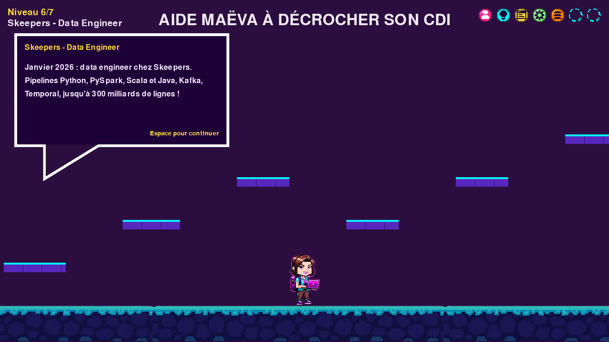
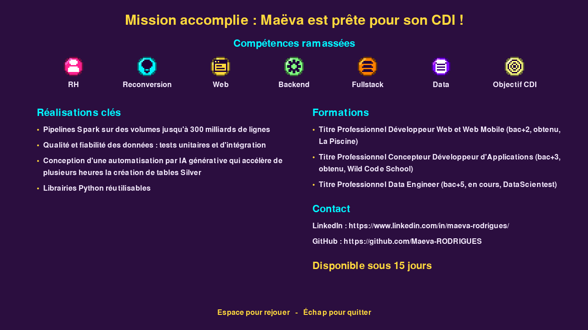

# Hack Ton Job - CV Game

[](https://github.com/Maeva-RODRIGUES/cvgame_python/actions/workflows/ci.yml)


**Data engineer à la recherche d'un CDI en développement back-end Python ou en data engineering**, j'ai raconté mon parcours sous la forme d'un petit jeu de plateforme en Python : 7 niveaux, 7 compétences à ramasser, un CDI au bout.

### [▶ Jouer en ligne](https://maeva-rodrigues.github.io/cvgame_python/)

Directement dans le navigateur, sans rien installer (premier chargement : quelques secondes).



---

## Le parcours en 3 lignes

1. **2010-2023** : 13 ans dans les ressources humaines, puis reconversion dans le développement.
2. **2024-2025** : titre Développeur Web et Web Mobile (bac+2), puis alternance chez CGI, en back-end ABAP sur SAP, puis en fullstack React / Node.js, avec le titre Concepteur Développeur d'Applications (bac+3).
3. **Depuis 2026** : data engineer chez Skeepers, sur des pipelines Python et PySpark qui traitent jusqu'à 300 milliards de lignes. Titre Data Engineer (bac+5) en cours.



---

## Ce que ce projet démontre

- **Architecture claire** : une classe `Game` pilotée par une machine à états (`TITLE`, `PLAYING`, `END`). La boucle suit toujours le même ordre : événements, puis logique, puis affichage.
- **Coordonnées monde et caméra** : les niveaux font jusqu'à 2 500 px de large. Tout est positionné dans le monde, et la caméra (bornée aux limites du niveau) convertit en coordonnées écran au moment du dessin.
- **Contenu séparé du code** : niveaux, dialogues et écran de fin sont dans des fichiers JSON (`data/`). Les niveaux sont **validés au chargement** avec des `dataclasses` : un champ manquant ou un badge inconnu donne un message clair, avec le niveau et le champ concernés.
- **Tests automatisés** (pytest, sans fenêtre) : chargement des niveaux, validation des données, découpage du texte, collisions, ramassage unique des badges. Un test simule de vrais sauts pour **garantir que chaque plateforme de chaque niveau est atteignable**.
- **Qualité et CI** : `ruff` (lint et formatage) et `pytest` tournent sur GitHub Actions à chaque push, avec Python 3.10 et 3.12.
- **Publication web** : la boucle de jeu est asynchrone pour tourner dans le navigateur avec pygbag (WebAssembly). Le site est reconstruit et publié sur GitHub Pages automatiquement quand la CI passe.

---

## Contrôles

| Touche | Action |
|---|---|
| ← → | Se déplacer |
| ↑ | Sauter |
| Espace | Ouvrir la bulle, accélérer le texte, la fermer |
| Échap | Quitter (écran de fin) |

---

## Installation

Prérequis : Python 3.10 ou plus récent.

**Mac / Linux**

```bash
git clone https://github.com/Maeva-RODRIGUES/cvgame_python.git
cd cvgame_python
python3 -m venv venv
source venv/bin/activate
pip install -r requirements.txt
python main.py
```

**Windows (PowerShell)**

```powershell
git clone https://github.com/Maeva-RODRIGUES/cvgame_python.git
cd cvgame_python
python -m venv venv
.\venv\Scripts\Activate.ps1
pip install -r requirements.txt
python main.py
```

**Pour développer** (tests, lint, version web) :

```bash
pip install -r requirements-dev.txt
python -m pytest           # tests
ruff check . && ruff format --check .
python -m pygbag .         # version navigateur sur http://localhost:8000
```

---

## Stack

| Outil | Version |
|---|---|
| Python | 3.10+ (testé en 3.10 et 3.12) |
| pygame | 2.6.1 (pygame-ce dans le navigateur) |
| pygbag | 0.9.3 |
| pytest | 9.2.0 |
| ruff | 0.17.3 |
| GitHub Actions / GitHub Pages | CI et hébergement |

## Structure

```
cvgame_python/
├── main.py              # Point d'entrée (boucle asynchrone)
├── settings.py          # Constantes : écran, physique, couleurs, chemins
├── utils.py             # Chargement d'images, découpage du texte
├── classes/             # Game (états), joueur, niveaux, badges, bulle, HUD, écran de fin
├── data/                # levels.json et end_screen.json : tout le contenu du jeu
├── assets/              # Sprites et sons
├── tests/               # Tests pytest
├── tools/make_badges.py # Génère les badges en pixel art
└── .github/workflows/   # CI (lint + tests) et déploiement GitHub Pages
```

---

## Crédits

- **Sprites** (personnage, panneau, sol, bulle, drapeau) : générés par IA puis retouchés.
- **Badges** : pixel art généré par le script `tools/make_badges.py`.
- **Sons** : [Pixabay](https://pixabay.com/), sous [Pixabay Content License](https://pixabay.com/service/license-summary/).

## Licence

Code sous licence [MIT](LICENSE).

## Contact

- LinkedIn : [linkedin.com/in/maeva-rodrigues](https://www.linkedin.com/in/maeva-rodrigues/)
- GitHub : [github.com/Maeva-RODRIGUES](https://github.com/Maeva-RODRIGUES)
